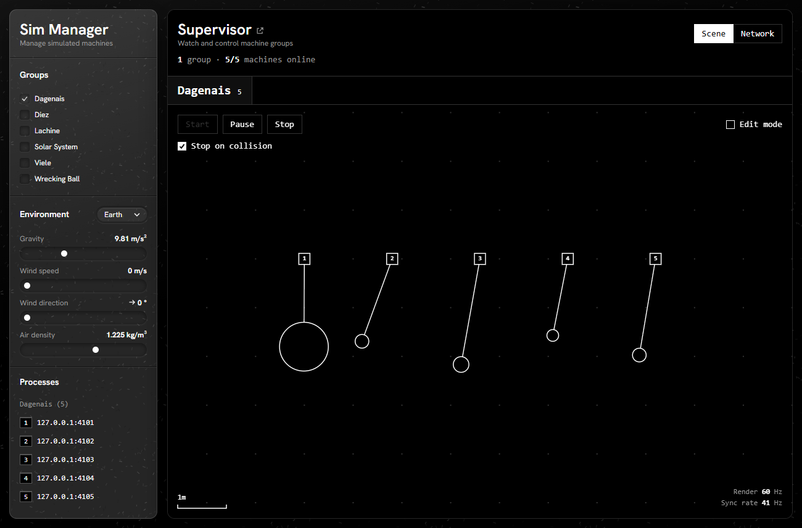
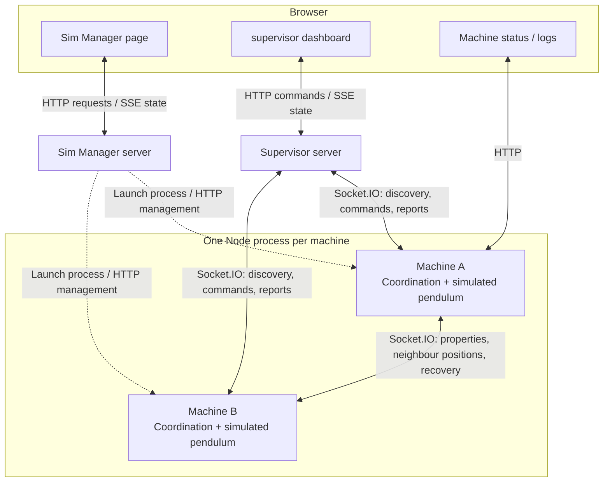

# Vention Pendulums

Built with the idea of the simulated instances being "real" machines, communicating with a Supervisor strictly through the network. The Supervisor is unaware that simulations exist.

Sim Manager spins up sims with specific configurations, giving them their Supervisor and group ID. After that, they coordinate with one another directly, the Supervisor only observes and visualises reported physical properties, and makes configuration requests through the network. It has no actual control or decision power.

Built with Node.js 24+, TypeScript, React.
Co-authored by Deepseek, ChatGPT, Claude, and Grok.



## Run it

```sh
npm i
npm run dev
```

This will start up a few things:

- Supervisor: http://127.0.0.1:4000
- Sim Manager: http://127.0.0.1:4050
  - Simulated Machines: http://127.0.0.1:4101 ~ 4199

Sim Manager is the place to start. They're separate, but for the sake of demo convenience, I embedded the Supervisor in a frame beside Sim Manager.

The first group starts by itself, and Ctrl+C stops everything. [Development](docs/development.md) covers the other ways to run it, but they're kind of boring.

## Test it

```sh
npm run check
```

Types, lint, builds and tests. [Testing](docs/testing.md) covers what's tested.

## A quick tour

There are three apps.

### [Sim Manager](apps/sim-manager/README.md)

Tool for starting and stopping instances, and telling them their environmental context. Starts a single process for each simulated machine, lets you choose which groups run. Embeds the Supervisor for convenience of the demo, but otherwise has no connection with it.

### [Sim Machine](apps/sim-machine/README.md)

Simulates one machine. It's provided environmental information, and who its Supervisor and group ID are. It then registers with the Supervisor, who informs it who else is in the group so it can connect to them. It's standalone, and a GET serves up info about itself.

### [Supervisor](apps/supervisor/README.md)

Introduces machines to each other, visualizes the group's reported positions, and allows requesting configuration changes of machines. It explicitly only knows what the machines tell it. It has no idea Sim Manager exists, or that the machines are simulated. It never works out collisions.

## How it fits together



_The Sim Manager page embeds the supervisor dashboard in an iframe, for demo convenience. Both web apps work on their own._

The apps never import each other. Anything they share, like the messages they send, lives in a package under [packages/](packages/). (There's not much there)

## Things that happen

### When a group starts

Each machine registers with the supervisor, which tells it who else is in its group. The machines connect to each other directly and share their properties, so each one knows which neighbours it could hit. Once everyone has arrived, the supervisor starts the group.

### When two pendulums collide

The first machine to notice tells the group to stop and begin [collision recovery](docs/messaging.md#collision-recovery).

### When you drag a pendulum

The supervisor's dashboard asks the machine through the network to change its position. Turn on Edit mode, and it asks to change its configuration instead: the anchor, the bob's size, and where it starts. What's shown on the dashboard after is simply the properties the machine was already reporting. The machine also broadcasts property changes to its connected peers.

## Things I'm not wild about

- How much code there is. It's a lot for what it is.
- Machines which can interact receive positional messages 45~60 times per second, so a fast collision can be caught late. [Time of impact](docs/notes/time-of-impact-estimation.md) could be a solution, but it's not implemented.
- Each machine counts down by its own clock, so a group doesn't restart at exactly the same instant. They can receive messages a bit out of order, e.g. receiving positional updates from a neighbour when you think you're still in restart count down.
- Every machine connects to every other machine in its group. That's fine for a few dozen, but it won't scale to large groups. Viele group network view illustrates this. I wish I'd used a better strategy.
- Sim Manager writes group files straight into the data folder, and Update writes over the one that's there. No backup, no undo. Yolo.

## More

- [Design decisions](docs/decisions.md)
- [Messaging](docs/messaging.md)
- [Development](docs/development.md)
- [Testing](docs/testing.md)
- [Notes](docs/notes/): collision detection, timer limits and time of impact
- [A note for reviewers](docs/a-note-for-reviewers.md)
