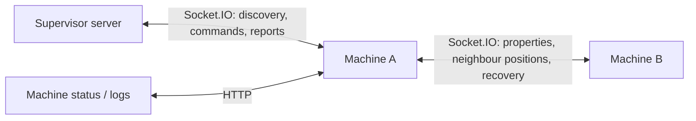

# Sim Machine

One simulated pendulum, running as its own program. It registers with the supervisor, connects to its peers, and coordinates collisions and restarts with them.

Physics stays inside the machine. Everything outside it works with reported measurements.



Start with [state.ts](src/state.ts) for everything the machine knows, then [machine.ts](src/machine.ts) for how commands, peer messages and each tick change it. [physics.ts](src/physics.ts) swings the pendulum, in steady steps from [fixedSteps.ts](src/fixedSteps.ts). [api.ts](src/api.ts) holds HTTP routes and [sockets.ts](src/sockets.ts) the connections. [index.ts](src/index.ts) starts it all.

## Status and logs

Status at `/`: everything the machine knows, what it reports to the supervisor, and how often it hears from each peer. Logs at `/logs`, one line each, newest first, kept in memory. Both are JSON, and refreshed manually. Change machine properties from the supervisor dashboard.

Its definition can say where its settings are kept. Whenever its properties change, it sends them there with a PUT, and deleting the machine asks it to delete them with a DELETE. Without one, changes last as long as the process, and it can't be deleted.

## Run

Sim Manager normally launches it. To run one yourself, set `MACHINE_DEFINITION` to JSON matching the definition in [state.ts](src/state.ts), then from the repository root:

```sh
node apps/sim-machine/src/index.ts
```

## Configuration

The sync rate and collision threshold live in [config.ts](config.ts).

| Variable             | Default                 | Purpose                                                    |
| -------------------- | ----------------------- | ---------------------------------------------------------- |
| `SUPERVISOR_URL`     | `http://127.0.0.1:4000` | Supervisor to register with                                |
| `MACHINE_DEFINITION` | required                | Identity, group, properties, environment, and port as JSON |
