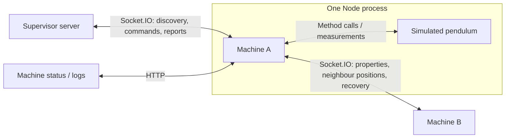

# Sim Machine

One simulated pendulum, running as its own program. It registers with the supervisor, connects to its peers, and coordinates collisions and restarts with them.

Physics stays inside the pendulum. Everything outside it works with reported measurements.



Start with [machine.ts](src/server/machine.ts) for group coordination, [recovery.ts](src/server/recovery.ts) for collision recovery, or [pendulum.ts](src/server/pendulum.ts) for the simulated device. [network/](src/server/network/) handles connections and HTTP routes.

## Status and logs

Status at `/`, logs at `/logs`. Both plain text, refreshed manually. Logs stay in memory. Change machine properties from the supervisor dashboard.

## Run

Sim Manager normally launches it. To run one yourself, set `MACHINE_DEFINITION` to JSON matching [definition.ts](src/server/definition.ts), then from the repository root:

```sh
node apps/sim-machine/src/server/index.ts
```

## Configuration

The sync rate and collision threshold live in [config.ts](config.ts).

| Variable             | Default                 | Purpose                                                    |
| -------------------- | ----------------------- | ---------------------------------------------------------- |
| `SUPERVISOR_URL`     | `http://127.0.0.1:4000` | Supervisor to register with                                |
| `MACHINE_DEFINITION` | required                | Identity, group, properties, environment, and port as JSON |
