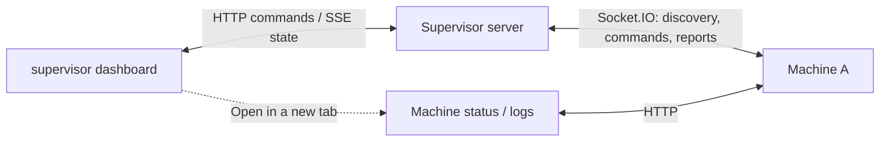

# Supervisor

Introduces machines to their group and gives you a dashboard to watch and control them. Commands go through the supervisor; the machines make the changes and report back.

Machine reports rebuild its view when machines reconnect. It also keeps Edit mode and the last requested collision setting for each group in memory. Those group controls reset when the supervisor restarts. It has no idea Sim Manager exists or that the machines are simulated. Collision recovery stays between the machines.



The backend has two entry points: [api.ts](src/server/api.ts) for HTTP routes and [sockets.ts](src/server/sockets.ts) for machine connections and commands. [state.ts](src/server/state.ts) holds the groups and what their machines last reported. [src/client/](src/client/) is the dashboard. [Messaging](../../docs/messaging.md) covers the commands and reports.

## Run

From the repository root:

```sh
npm run supervisor
```

Open http://127.0.0.1:4000. Client changes hot reload. Run Sim Manager separately if you need simulated machines.

## Configuration

Addresses and update rates live in [config.ts](config.ts).

| Variable                | Default     | Purpose                                 |
| ----------------------- | ----------- | --------------------------------------- |
| `SUPERVISOR_HOST`       | `127.0.0.1` | Listen address                          |
| `SUPERVISOR_PORT`       | `4000`      | Dashboard, API, and machine connections |
| `SUPERVISOR_HOT_RELOAD` | off         | `true` serves the client through Vite   |
