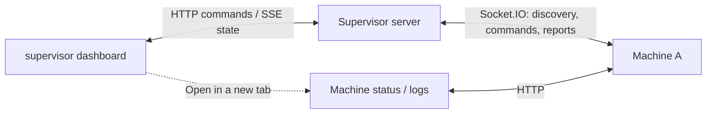

# Supervisor

Introduces machines to their group and gives you a dashboard to watch and control them. Commands go through the supervisor; the machines make the changes and report back.

It keeps reported state in memory and rebuilds it when machines reconnect. It has no idea Sim Manager exists or that the machines are simulated. Collision recovery stays between the machines.



Start in [src/server/](src/server/) for discovery and commands, or [src/client/](src/client/) for the dashboard. [Messaging](../../docs/messaging.md) covers the commands and reports.

## Run

From the repository root:

```sh
npm run supervisor
```

Open http://127.0.0.1:4000. Client changes hot reload. Run Sim Manager separately if you need simulated machines.

## Configuration

Addresses and update rates live in [config.ts](config.ts).

| Variable                | Default     | Purpose                                 |
| ----------------------- | ----------- | --------------------------------------- |
| `SUPERVISOR_HOST`       | `127.0.0.1` | Listen address                          |
| `SUPERVISOR_PORT`       | `4000`      | Dashboard, API, and machine connections |
| `SUPERVISOR_HOT_RELOAD` | off         | `true` serves the client through Vite   |
